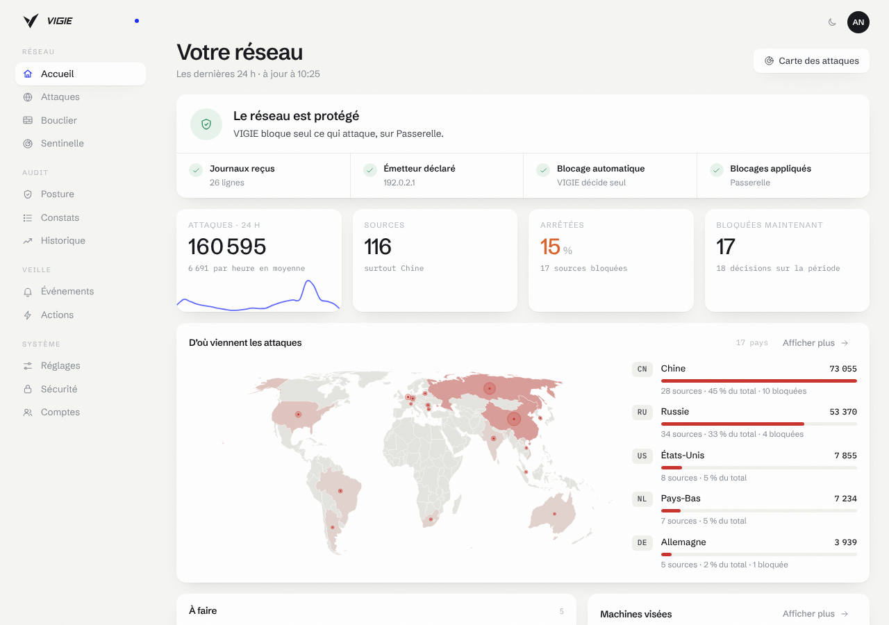
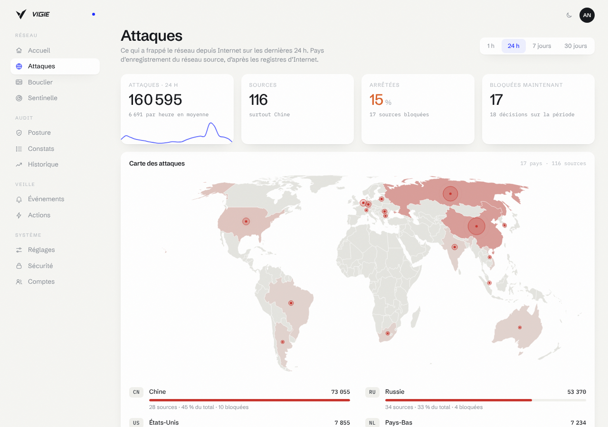

<p align="center">
  <picture>
    <source media="(prefers-color-scheme: dark)" srcset="medias/logo-sombre.svg">
    
  </picture>
</p>

<p align="center"></p>

# Vigie

**Network security audit and monitoring for your own LAN: posture score per domain, attack map, automatic blocking at the gateway — with or without AI.**

<p align="center">

[](https://github.com/Nesaris/Vigie/stargazers)
[](LICENSE)


</p>

<p align="center"><a href="README.fr.md">Full documentation</a> · <a href="https://nesaris.github.io">Nesaris Network</a></p>

## Why Vigie?

You can collect logs and scan results all day, but the real question is: *is my network actually protected?* Vigie answers it, shows what attacked you in the last 24 hours, and gives the fix next to every finding.

## Features

- **Deterministic engine** — fixed rules, same inputs give the same result; a score per domain from green to red, with the fix next to each finding.
- **AI of your choice** — local (Ollama, nothing leaves your network), cloud, both or none; the AI reviews findings and writes the summary but never changes severities or the score.
- **Continuous watch** every 15 minutes by default.
- **Shield** — reads your UniFi gateway logs and blocks attackers automatically.
- **Sentinel** — reads the logs of your hosts (SSH, sudo, accounts, cron…).
- **Attack map** by source country, **PDF reports** in one click.
- Built on top of [MapMyLAN](https://github.com/Nesaris/MapMyLAN) (required) and NexArc / Ollama / Synapse when installed.

## Screenshots

<table>
<tr><td align="center" width="50%"><br><sub>Home: protection, attacks, to-do</sub></td><td align="center" width="50%"><br><sub>Attack map</sub></td></tr>
<tr><td align="center" width="50%"><br><sub>Posture score per domain</sub></td><td align="center" width="50%"><br><sub>Findings and fixes</sub></td></tr>
<tr><td align="center" width="50%"><br><sub>Gateway shield</sub></td></tr>
</table>

## Quick start

Install it from the [Nesaris Hub](https://github.com/Nesaris/Hub): **Catalog → Vigie** (MapMyLAN required). Standalone:

```bash
git clone https://github.com/Nesaris/Vigie && cd Vigie
cp .env.example .env    # VIGIE_HUB_TOKEN, MAPMYLAN_URL, MAPMYLAN_JETON (see docs/INTEGRATION.md)
mkdir -p secrets && openssl rand -base64 32 > secrets/socle_cle && : > secrets/socle_cle_ancienne
sudo chown 10004:10004 secrets/socle_cle secrets/socle_cle_ancienne && sudo chmod 400 secrets/socle_cle secrets/socle_cle_ancienne
docker compose up -d --build
docker compose logs vigie | grep "Jeton d'installation"   # one-time setup token
```

Full documentation (configuration, backups, key rotation, reverse proxy, upgrades) is in **[README.fr.md](README.fr.md)**.

## Part of Nesaris Network

Vigie is one of the self-hosted tools of **[Nesaris Network](https://nesaris.github.io)**. Every service shares the same hardened core (accounts, passkeys, TOTP, audit log, encrypted secrets), runs on Node.js 24 with **zero npm dependencies**, and can be installed in one click from the **[Nesaris Hub](https://github.com/Nesaris/Hub)**.

Other projects: [Hub](https://github.com/Nesaris/Hub) · [MapMyLAN](https://github.com/Nesaris/MapMyLAN) · [NexArc](https://github.com/Nesaris/NexArc) · [ProxLab](https://github.com/Nesaris/ProxLab) · [Relay](https://github.com/Nesaris/Relay) · [Nesmail](https://github.com/Nesaris/Nesmail) · [Synapse](https://github.com/Nesaris/Synapse) · [Dialekt](https://github.com/Nesaris/Dialekt)

## Contributing

Issues and pull requests are welcome. If Vigie is useful to you, a ⭐ helps a lot — it's how other people find the project.

## License

[MIT](LICENSE) — made by [CodeX64](https://codexx64.github.io).
